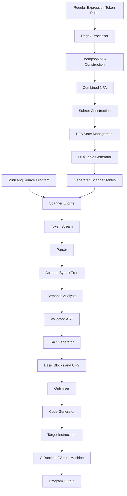
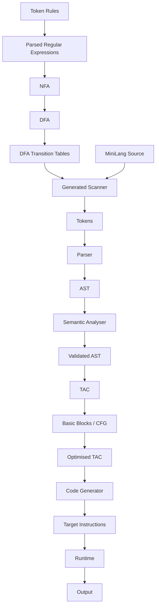

# REGEXTOOL – System Architecture and Module Interfaces

**Course:** CENP4111 – Introduction to Compiler Construction  
**Topic:** 15 – Mini-Flex Scanner Generator and Its Compiler  
**Lead Module:** 2.2 – Regular Expressions and Automata  
**Implementation Language:** C  
**Target Platform:** Linux / GCC  
**Document:** D1-01  
**Version:** 1.1 – 

---

## 1. Project Overview

REGEXTOOL is a C-based scanner generator integrated with a mini-compiler. It accepts token definitions written as regular expressions, converts them into a Deterministic Finite Automaton (DFA), generates scanner transition tables and uses those tables to recognise tokens in source programs.

Unlike a conventional compiler that relies on a manually implemented scanner, REGEXTOOL constructs its scanner from user-defined token rules.

The project has two connected subsystems.

### A. Scanner Generator

The scanner generator performs the following operations:

1. Reads and validates regular-expression token definitions.
2. Parses the regular expressions.
3. Converts each expression into an NFA using Thompson's Construction.
4. Combines the individual NFAs while preserving token identities and rule priorities.
5. Converts the combined NFA into a DFA using Subset Construction.
6. Removes unreachable states and applies the agreed state-management strategy.
7. Generates DFA transition tables and accepting-state information.

### B. Mini-Compiler

The mini-compiler uses the generated scanner to compile programs written in the REGEXTOOL MiniLang.

Its stages are:

1. Lexical analysis.
2. Syntax analysis and AST construction.
3. Semantic analysis and symbol-table management.
4. Three-Address Code generation.
5. Basic-block identification and Control Flow Graph construction.
6. Code optimisation.
7. Target-code generation.
8. Runtime execution.

The core regular-expression, NFA, DFA and scanner-table algorithms must be implemented from scratch in C.

The project must demonstrate that the generated scanner correctly recognises the language's tokens and drives the complete mini-compiler pipeline.

## 2. Project Scope and MiniLang Specification

Because the project has a three-day implementation deadline, the team will implement a deliberately limited language.

The reduced scope does not remove any of the required compiler-construction phases. Instead, it limits the number of language features that must be supported.

### 2.1 Supported Language Features

| Feature | Required support |
|---|---|
| Data type | Integer (`int`) |
| Variables | Declaration and assignment |
| Arithmetic | Addition, subtraction, multiplication and division |
| Grouping | Parentheses |
| Output | `print` |
| Conditional execution | `if` |
| Repetition | `while` |
| Comparison | `==`, `!=`, `<`, `<=`, `>` and `>=` |
| Blocks | `{ }` |
| Comments | Single-line comments, `// ...` |

### 2.2 Excluded Features

The MVP will not implement:

- Floating-point numbers.
- Strings.
- Arrays.
- Functions or procedures.
- Classes or objects.
- User-defined data types.
- Logical operators such as `&&` and `||`.
- Nested function scopes.
- Complex runtime libraries.

These exclusions keep the implementation manageable without removing the required compiler phases.

### 2.3 Example MiniLang Program

```c
int a;
int b;
int result;

a = 10;
b = 5;

result = a + b * 2;

if (result > 15) {
    print(result);
}

while (a > 0) {
    a = a - 1;
}

print(a);
```

The compiler must be able to process this program through the generated scanner, parser, semantic analyser, intermediate-code generator, optimiser and code generator.

## 3. Overall System Architecture

REGEXTOOL consists of two connected subsystems.

### 3.1 Scanner Generator

| Component | Responsibility |
|---|---|
| Regex Processor | Reads, parses and validates regular-expression token definitions. |
| NFA Generator | Builds NFAs using Thompson's Construction. |
| NFA Combiner | Combines individual token NFAs into a common NFA while preserving token information. |
| DFA Generator | Converts the combined NFA into a DFA using Subset Construction. |
| DFA State Manager | Removes unreachable states and enforces the agreed state limit; minimises states where feasible. |
| DFA Table Generator | Produces transition tables and accepting-state information. |

### 3.2 Mini-Compiler

| Component | Responsibility |
|---|---|
| Generated Scanner | Uses the generated DFA tables to recognise source-code tokens. |
| Parser | Checks grammar rules and constructs an AST. |
| Semantic Analyser | Maintains the symbol table and performs semantic checks. |
| Intermediate Code Generator | Converts the validated AST into Three-Address Code. |
| Optimiser | Identifies basic blocks, constructs a CFG and performs at least two optimisations. |
| Code Generator | Converts optimised TAC into the selected target instruction format. |
| Runtime | Executes the generated target instructions. |
| Main Driver | Coordinates scanner generation and all compiler stages. |

## 4. Complete Processing Pipeline

The system operates in two connected phases.

### 4.1 Phase A: Scanner Generation

1. Read the token-rule definitions.
2. Parse and validate the regular expressions.
3. Convert each expression into an NFA using Thompson's Construction.
4. Combine the token NFAs using a common start state and epsilon transitions.
5. Preserve token types and rule priorities in the combined NFA.
6. Calculate the epsilon closure of the NFA start state.
7. Apply Subset Construction to generate the DFA.
8. Identify accepting DFA states and their corresponding token types.
9. Remove unreachable states.
10. Apply the agreed DFA state limit and minimisation strategy.
11. Generate the DFA transition table and accepting-state metadata.
12. Pass the generated scanner tables to the scanner engine.

### 4.2 Phase B: Compilation

1. Read the MiniLang source program.
2. Initialise the scanner using the generated DFA tables.
3. Recognise lexemes and produce tokens.
4. Pass tokens to the parser.
5. Perform syntax analysis and construct the AST.
6. Perform semantic analysis using the symbol table.
7. Generate Three-Address Code.
8. Divide the TAC into basic blocks.
9. Construct the Control Flow Graph.
10. Perform at least two meaning-preserving optimisations.
11. Generate target instructions.
12. Execute the instructions using the runtime.

Each phase must report errors appropriately. Processing must stop when a fatal error prevents the next phase from operating correctly.

## 5. Regular Expression Specification

The regex processor must support the operators required for the scanner generator and the additional basic character constructs needed to recognise MiniLang tokens.

### 5.1 Supported Regular-Expression Constructs

| Construct | Meaning | Example |
|---|---|---|
| Concatenation | Joins expressions | `ab` |
| Alternation | Matches either expression | `a|b` |
| Kleene star | Matches zero or more repetitions | `a*` |
| Parentheses | Groups expressions | `(ab)*` |
| Character classes | Matches one character from a set | `[a-z]` |
| Character ranges | Matches characters in a range | `[0-9]` |
| Escaped characters | Represents special characters literally | `\*` |

The implementation must recognise operator precedence:

1. Parentheses.
2. Kleene star.
3. Concatenation.
4. Alternation.

Implicit concatenation must be handled correctly by the regex parser.

### 5.2 Token-Rule File Format

The team will use a simple token-definition format:

```text
INT       [0-9][0-9]*
IDENT     [A-Za-z_][A-Za-z0-9_]*
PLUS      \+
MINUS     -
MULTIPLY  \*
DIVIDE    /
ASSIGN    =
EQUAL     ==
LESS      <
LESS_EQUAL <=
GREATER   >
GREATER_EQUAL >=
NOT_EQUAL !=
LPAREN    \(
RPAREN    \)
LBRACE    \{
RBRACE    \}
SEMICOLON ;
WHITESPACE [ \t\r\n][ \t\r\n]*
```

The token-rule file defines token patterns and their priority order.

Keywords such as `int`, `if`, `while` and `print` will initially be recognised through identifier matching followed by a keyword lookup. This avoids requiring separate keyword NFAs.

Whitespace tokens must be recognised and skipped by the scanner.

The scanner must also recognise single-line comments and ignore them. This may be implemented as a dedicated comment rule in the token specification.

### 5.3 Token Priority

When multiple token rules accept the same longest lexeme, the scanner must select the token with the highest priority.

The rule appearing first in the token-rule file has the highest priority unless an explicit priority is defined.

For example, when `==` and `=` are both possible matches, the longest match must be selected.

When an identifier lexeme matches a reserved keyword, keyword lookup must convert the token to the corresponding keyword type.

## 6. Regular Expression to NFA to DFA

This is the central algorithmic component of Topic 15.

### 6.1 Regular Expression to NFA

Thompson's Construction must be implemented from scratch.

Each supported regular-expression operation must produce an NFA fragment.

The construction must support:

- Basic symbol transitions.
- Character-class transitions.
- Concatenation.
- Alternation.
- Kleene closure.
- Epsilon transitions.

Every generated NFA must have a clearly defined start state and accepting state or states.

The combined NFA must preserve the identity and priority of each token rule.

### 6.2 NFA to DFA

Subset Construction must also be implemented from scratch.

The algorithm must:

1. Calculate epsilon closure of the NFA start state.
2. Use that closure as the initial DFA state.
3. Calculate the move operation for each supported input symbol.
4. Calculate epsilon closure of each resulting set.
5. Compare each new set against previously generated DFA states.
6. Add only previously unseen state sets.
7. Repeat until no new DFA states are generated.
8. Identify accepting DFA states.
9. Associate each accepting state with the correct token type and priority.

A DFA state represents a set of NFA states.

Duplicate state sets must not be inserted as separate DFA states.

### 6.3 DFA Table Generation

The generated DFA must be represented using a transition table.

For the MVP, the scanner will use an ASCII input alphabet represented by unsigned character values.

A conceptual representation is:

```c
typedef struct {
    int state_count;
    int start_state;
    int **transitions;
    TokenType *accepting_tokens;
} ScannerTables;
```

The actual implementation may extend this structure to preserve rule priorities and additional accepting-state information.

A transition value of `-1` represents an invalid or missing transition.

The scanner must use the generated transition table rather than independently interpreting the original regular expressions.

### 6.4 DFA State Explosion

Subset Construction can generate many DFA states, particularly as the number of NFA states increases.

The implementation must therefore include:

1. Duplicate DFA state-set detection.
2. Removal of unreachable states.
3. A documented maximum DFA-state limit.
4. Clear error reporting when the limit is exceeded.
5. DFA minimisation where feasible within the implementation deadline.

The state limit must never cause the program to silently discard states or generate an incorrect scanner.

The report must explain the selected strategy, its limitations and its effect on the generated DFA.

## 7. Scanner Recognition Rules

The generated scanner must support the following requirements.

### 7.1 Longest Match

The scanner must continue reading characters while valid DFA transitions exist and remember the last accepting state.

When no further transition is possible, it must return the lexeme associated with the longest accepted match.

### 7.2 Keyword Priority

When an identifier matches a reserved keyword, the scanner must return the corresponding keyword token.

For example:

```text
int
```

must be recognised as a keyword rather than a general identifier.

### 7.3 Lexical Error Detection

The scanner must report:

- Unrecognised characters.
- Invalid lexemes.
- Source line and column positions.
- Relevant lexical error messages.

### 7.4 Scanner Interface

The scanner receives the generated DFA tables and the source program.

The shared token structure will be defined in a common header:

```c
typedef struct {
    TokenType type;
    char *lexeme;
    int line;
    int column;
} Token;
```

The scanner interface will follow this design:

```c
bool scanner_init(
    Scanner *scanner,
    const char *source,
    const ScannerTables *tables
);

bool scanner_next_token(
    Scanner *scanner,
    Token *token
);

void scanner_destroy(Scanner *scanner);
void token_destroy(Token *token);
```

The scanner must not expose internal NFA or DFA construction details to the parser.

The parser receives only tokens through the scanner interface.

The token's lexeme memory must have a clearly defined ownership and release mechanism to prevent memory leaks.

## 8. Grammar and Syntax Analysis

The MiniLang grammar must be documented and implemented.

The parser will use recursive-descent predictive parsing for the MVP, provided the implemented grammar remains suitable for this approach.

The parser must construct an Abstract Syntax Tree.

### 8.1 Proposed MiniLang Grammar

The following grammar establishes the language's initial syntax:

```text
Program       → StatementList

StatementList → Statement StatementList
              | ε

Statement     → Declaration
              | Assignment
              | PrintStatement
              | IfStatement
              | WhileStatement
              | Block

Declaration   → int IDENT ;

Assignment    → IDENT = Expression ;

PrintStatement → print ( Expression ) ;

IfStatement   → if ( Condition ) Block

WhileStatement → while ( Condition ) Block

Block         → { StatementList }

Condition     → Expression RelationalOperator Expression

RelationalOperator → ==
                    | !=
                    | <
                    | <=
                    | >
                    | >=

Expression    → Term ExpressionTail

ExpressionTail → + Term ExpressionTail
               | - Term ExpressionTail
               | ε

Term          → Factor TermTail

TermTail      → * Factor TermTail
              | / Factor TermTail
              | ε

Factor        → IDENT
              | INT
              | ( Expression )
```

The grammar defines arithmetic precedence, with multiplication and division taking precedence over addition and subtraction.

The grammar also removes left recursion from arithmetic expressions.

### 8.2 Required Grammar Analysis

The team must demonstrate:

- Grammar production rules.
- At least one derivation.
- The corresponding parse tree.
- Identification and resolution of ambiguity.
- Removal of left recursion where necessary.
- Left factoring where necessary.
- FIRST and FOLLOW sets.
- A shift-reduce operation example.
- Handle pruning.
- An LR(0) or SLR parsing table for a suitable grammar fragment.

The actual parser implementation and the theoretical LR demonstration are separate deliverables.

The MVP parser does not need to be rewritten as an LR parser solely to demonstrate LR concepts. The report must, however, contain a correct worked example of shift-reduce parsing, handle pruning and the relevant LR table.

## 9. Semantic Analysis and Symbol Table

The semantic analyser receives the AST and checks whether the program is semantically valid.

### 9.1 Symbol Table

The symbol table must store:

- Identifier name.
- Data type.
- Declaration status.
- Storage location or assigned slot.
- Any additional information required by the code generator.

The MVP uses integer variables and a single global scope.

### 9.2 Required Semantic Checks

The semantic analyser must detect:

1. Use of an undeclared variable.
2. Duplicate variable declarations.
3. Assignment to undeclared identifiers.
4. Invalid type assignments.
5. Invalid arithmetic operations.
6. Invalid comparison operations.
7. Division by zero where it can be determined statically.

Since the MVP supports only integers, type checking can remain relatively simple while still demonstrating the semantic-analysis phase.

The analyser must report meaningful errors with source positions where available.

## 10. Intermediate Code Generation

The intermediate code generator converts a semantically validated AST into Three-Address Code.

### 10.1 TAC for Arithmetic

For example:

```c
result = a + b * 2;
```

May produce:

```text
t1 = b * 2
t2 = a + t1
result = t2
```

### 10.2 TAC for Output

```c
print(result);
```

May produce:

```text
PRINT result
```

### 10.3 TAC for Conditional Statements

```c
if (a > b) {
    print(a);
}
```

May produce:

```text
t1 = a > b
IF_FALSE t1 GOTO L1
PRINT a
L1:
```

### 10.4 TAC for Loops

```c
while (a > 0) {
    a = a - 1;
}
```

May produce:

```text
L1:
t1 = a > 0
IF_FALSE t1 GOTO L2
t2 = a - 1
a = t2
GOTO L1
L2:
```

The TAC representation must use consistent instruction structures, temporary identifiers and labels.

### 10.5 Postfix Demonstration

The report must also include at least one expression converted into postfix notation and explain its relationship to expression evaluation.

## 11. Optimisation and Control Flow Analysis

The optimiser receives TAC and performs basic-block and control-flow analysis before applying optimisations.

### 11.1 Basic Blocks

The implementation must identify basic blocks using leaders:

- The first instruction.
- Any instruction that is the target of a jump.
- Any instruction immediately following a jump.

Each basic block must have a defined entry and exit.

### 11.2 Control Flow Graph

The optimiser must construct a Control Flow Graph in which:

- Nodes represent basic blocks.
- Directed edges represent possible control transfers.
- Conditional and unconditional jumps determine the edges.

### 11.3 Required Optimisations

At least two meaning-preserving optimisations must be implemented.

The minimum selected techniques are:

**1. Constant Folding**

Evaluate expressions whose operands are compile-time constants.

Before:

```text
t1 = 4 * 5
t2 = t1 + 2
```

After:

```text
t1 = 20
t2 = 22
```

**2. Dead-Temporary Elimination**

Remove temporary computations whose results are never used and which have no observable side effects.

Before:

```text
t1 = a + b
t2 = c * d
PRINT t1
```

After:

```text
t1 = a + b
PRINT t1
```

The optimiser must not remove assignments to variables when doing so could change observable program behaviour.

The report must include before-and-after examples and explain why each optimisation preserves the meaning of the program.

## 12. Code Generation and Runtime

### 12.1 Target Format

The MVP will use a small register-based virtual instruction set.

The target instructions will be executed by a runtime implemented in C.

The virtual machine will use:

- A small fixed set of registers.
- Variable storage slots.
- Temporary storage or spill slots.
- Labels for control flow.
- Conditional and unconditional jumps.

### 12.2 Example Target Instructions

The target instruction set may include:

```text
LOADI R0, 10
LOADI R1, 5
ADD R2, R0, R1
STORE result, R2
PRINT R2
JMP L1
JZ R0, L2
HALT
```

The final instruction set must be documented in the target-instruction specification before the code generator and runtime are integrated.

### 12.3 Code Generation Requirements

The code generator must demonstrate:

1. Translation of arithmetic TAC into target instructions.
2. Translation of assignments.
3. Translation of print instructions.
4. Translation of conditional branches.
5. Translation of loops.
6. Sethi–Ullman labelling for expression evaluation.
7. Simple register allocation.
8. Spill or storage management where required.

### 12.4 Sethi–Ullman Labelling

The code generator must calculate Sethi–Ullman labels for expression trees and use them to determine an efficient evaluation order.

The report must include at least one worked example showing the labels and evaluation order.

### 12.5 Activation Records

The MVP has no user-defined functions or recursive procedure calls.

It will therefore use a single program activation record containing:

- Variable storage slots.
- Temporary storage slots.
- Spill slots where necessary.
- Runtime state required for execution.

The report must explain this simplified activation-record design and why a full call stack is unnecessary for the selected language.

### 12.6 Runtime

The runtime must execute the generated virtual instructions.

It must support:

- Register operations.
- Loading and storing values.
- Arithmetic operations.
- Comparisons.
- Printing.
- Conditional jumps.
- Unconditional jumps.
- Program termination.
- Runtime error reporting.

The runtime must be implemented in `runtime.c` and exposed through its corresponding header.

## 13. System Architecture Diagram



The scanner engine and generated DFA tables together form the generated scanner used by the mini-compiler.

## 14. Compiler Data-Flow Diagram



## 15. Compiler Construction T-Diagram

The compiler being constructed translates the REGEXTOOL MiniLang into the selected virtual-machine instruction language.

```text
              SOURCE LANGUAGE
                 MiniLang
                    |
                    |
          -----------------------
          |                     |
          |     REGEXTOOL       |
          |                     |
          -----------------------
                    |
                    |
              TARGET LANGUAGE
            REGEXTOOL VM Code
```

**Implementation language:** C  
**Host environment:** Linux / GCC

The scanner generator is a supporting construction stage. It converts regular-expression token definitions into DFA tables that the MiniLang compiler uses for lexical analysis.

The report must explain the source language, target language and implementation language represented by the T-diagram.

## 16. Module Interfaces and Shared Data Structures

All modules must use agreed data structures and function interfaces.

Shared structures must be declared in the appropriate header files.

### 16.1 Module Responsibilities

| Module | Input | Output |
|---|---|---|
| Regex Processor | Token-rule definitions | Parsed regex structures |
| NFA Generator | Parsed regex structures | NFA |
| DFA Generator | Combined NFA | DFA |
| DFA Table Generator | DFA | Scanner tables |
| Scanner | Source program and scanner tables | Token stream |
| Parser | Token stream | AST |
| Semantic Analyser | AST | Validated AST and symbol-table information |
| IR Generator | Validated AST | TAC |
| Optimiser | TAC | Basic blocks, CFG and optimised TAC |
| Code Generator | Optimised TAC | Target instructions |
| Runtime | Target instructions | Program execution and output |

### 16.2 Interface Rules

1. Each module must expose its public functions through a header file.
2. Internal implementation details must remain within the responsible module.
3. Shared structures must not be independently redefined.
4. Interface changes must be communicated to dependent module owners.
5. Modules must be tested independently before integration.
6. All dynamically allocated memory must have a clear ownership and release strategy.
7. Errors must be returned or recorded consistently.

The integration lead is responsible for ensuring that the interfaces remain compatible.

## 17. Error Handling

Errors must be reported at the stage where they occur.

| Phase | Example error |
|---|---|
| Regex processing | Malformed regular expression |
| NFA/DFA generation | State limit exceeded |
| Scanner | Unrecognised character |
| Parser | Missing semicolon or unexpected token |
| Semantic analysis | Undeclared variable |
| TAC generation | Invalid AST input |
| Optimisation | Invalid or inconsistent intermediate instruction |
| Code generation | Unsupported TAC instruction |
| Runtime | Division by zero or invalid target instruction |

Each error should include a meaningful description and source position when available.

A fatal error must prevent later compiler phases from operating on invalid input.

## 18. Project Folder Structure

The project will use the agreed modular structure:

```text
REGEXTOOL/
│
├── docs/
│   ├── architecture.md
│   ├── regex-specification.md
│   ├── grammar.md
│   ├── semantic-design.md
│   ├── algorithms.md
│   ├── design-decisions.md
│   ├── hand-calculations.md
│   └── T-diagram.png
│
├── include/
│   ├── regex.h
│   ├── automata.h
│   ├── scanner.h
│   ├── parser.h
│   ├── semantic.h
│   ├── ir.h
│   ├── optimiser.h
│   ├── codegen.h
│   └── runtime.h
│
├── src/
│   ├── regex.c
│   ├── nfa.c
│   ├── dfa.c
│   ├── scanner.c
│   ├── parser.c
│   ├── semantic.c
│   ├── ir.c
│   ├── optimiser.c
│   ├── codegen.c
│   ├── runtime.c
│   └── main.c
│
├── tests/
│   ├── valid/
│   ├── invalid/
│   └── expected/
│
├── examples/
│   ├── rules/
│   └── programs/
│
├── report/
│   ├── final-report.docx
│   └── presentation.pptx
│
├── Makefile
├── README.md
├── CONTRIBUTIONS.md
└── .gitignore
```

### Folder Responsibilities

- `docs/`: Architecture, algorithms, grammar, semantic rules and design documentation.
- `include/`: Public module interfaces and shared structures.
- `src/`: C implementation files.
- `tests/valid/`: Programs and inputs expected to compile successfully.
- `tests/invalid/`: Programs and inputs expected to produce errors.
- `tests/expected/`: Expected outputs and test results.
- `examples/rules/`: Regular-expression token definitions.
- `examples/programs/`: MiniLang demonstration programs.
- `report/`: Final academic report and presentation.
- `Makefile`: Build and test commands.
- `README.md`: Project description, setup, grammar and execution instructions.
- `CONTRIBUTIONS.md`: Record of team contributions.

No additional implementation modules should be introduced without agreement from the integration lead.

## 19. Module Dependencies and Integration

The dependency sequence is:

```text
Regex Processor
      |
      v
NFA Generator
      |
      v
DFA Generator
      |
      v
DFA Table Generator
      |
      v
Generated Scanner
      |
      v
Parser
      |
      v
Semantic Analyser
      |
      v
Intermediate Code Generator
      |
      v
Optimiser
      |
      v
Code Generator
      |
      v
Runtime
```

The main driver coordinates the complete process.

The scanner generator must finish generating valid DFA tables before the scanner can initialise.

The parser depends on the scanner's token interface. The semantic analyser depends on the parser's AST structures. The IR generator depends on the validated AST. The optimiser depends on the agreed TAC representation. The code generator depends on the optimised TAC and target instruction specification. The runtime depends on the target instruction format.

Each module must be tested independently before integration.

The integration lead must ensure that the generated scanner actually drives the mini-compiler.

## 20. Testing and Correctness

Testing must cover both individual modules and the complete compiler.

### 20.1 Scanner Generator Tests

- Valid regular-expression parsing.
- Invalid regular-expression detection.
- Correct Thompson NFA construction.
- Correct epsilon closure.
- Correct subset construction.
- Duplicate DFA-state prevention.
- Correct accepting-state identification.
- DFA state growth and state-limit handling.
- Correct transition-table generation.

### 20.2 Scanner Tests

- Identifier recognition.
- Integer recognition.
- Keyword recognition.
- Operator recognition.
- Longest-match behaviour.
- Keyword priority.
- Whitespace handling.
- Comment handling.
- Lexical error reporting.
- Correct line and column positions.

### 20.3 Compiler Tests

- Valid declarations and assignments.
- Arithmetic expressions and precedence.
- Parenthesised expressions.
- Print statements.
- Conditional statements.
- While loops.
- Syntax errors.
- Undeclared variables.
- Duplicate declarations.
- Invalid assignments.
- TAC generation.
- Basic-block construction.
- CFG construction.
- Constant folding.
- Dead-temporary elimination.
- Target-code generation.
- Runtime execution.

### 20.4 End-to-End Testing

At least one complete valid MiniLang program must pass through all compiler stages and produce the expected output.

At least one invalid program must demonstrate that an appropriate error is detected and reported.

The tests must demonstrate that the scanner used by the compiler is generated from the supplied token rules.

### 20.5 Correctness Argument

The report must explain the correctness of the major stages.

In particular:

1. Thompson's Construction produces an NFA that recognises the same language as the original regular expression.
2. Subset Construction produces a DFA equivalent to the combined NFA.
3. The generated scanner recognises the expected token sequences according to longest-match and priority rules.
4. The parser constructs an AST corresponding to the accepted grammar.
5. Semantic analysis rejects programs that violate the defined language rules.
6. TAC represents the validated program's operations and control flow.
7. Optimisations preserve program behaviour.
8. Code generation and runtime execution preserve the intended result of the source program.

The correctness argument should be supported by worked examples and test evidence.

## 21. Academic and Submission Requirements

The implementation must demonstrate the compiler-construction concepts covered in Modules 1–7.2.

| Module | Required evidence |
|---|---|
| Module 1 | Compiler phases, passes and T-diagram |
| Module 2 | Token specification, regular expressions, NFA, DFA, scanner and longest-match |
| Module 3 | Grammar, derivation, parse tree, ambiguity resolution, left-recursion removal, left factoring, FIRST and FOLLOW |
| Module 4 | Shift-reduce operations, handle pruning and LR(0)/SLR table for a grammar fragment |
| Module 5.1 | Symbol table, declaration-before-use and type checking |
| Module 5.2 | TAC and postfix representation |
| Module 6.1 | Basic blocks, CFG and at least two optimisations |
| Module 6.2 | Target code, Sethi–Ullman labelling, register allocation and activation-record considerations |
| Module 7.1 | Integrated compiler, driver, error handling and correctness argument |
| Module 7.2 | GitHub repository, report, presentation and defence |

### 21.1 Final Report

The report must be 6–10 pages and include:

1. Project introduction and objectives.
2. Compiler phases and T-diagram.
3. Token specification and regex processing.
4. Thompson NFA and Subset Construction.
5. DFA table generation and state-management strategy.
6. Grammar, FIRST/FOLLOW and LR demonstration.
7. Symbol table and semantic rules.
8. TAC and postfix representation.
9. Basic blocks, CFG and optimisation examples.
10. Code generation, Sethi–Ullman labelling and register allocation.
11. Testing and correctness argument.
12. Three justified design decisions.
13. Limitations and conclusion.

### 21.2 Presentation and Defence

- Maximum of seven slides.
- Ten-minute practical demonstration.
- Five-minute question-and-answer session.
- Demonstrate scanner generation, token recognition and complete compilation.
- Include at least one valid program and one invalid program in the demonstration.

### 21.3 Individual Contribution Requirements

Each member must maintain evidence of meaningful participation.

The individual requirements are:

- At least eight significant commits.
- At least two pull requests opened.
- At least one pull request reviewed.
- At least one signed hand calculation.
- At least one authored and justified design decision.

Contributions must represent genuine work. Commit counts must not be artificially inflated through meaningless changes.

The `CONTRIBUTIONS.md` file must document the actual work performed by each member.

## 22. Three-Day Implementation Plan

The implementation deadline requires a strict division of work.

### Day 1 – Architecture and Design

- Establish the repository and project structure.
- Define the MiniLang scope and grammar.
- Define the regular-expression syntax.
- Agree on shared structures and function interfaces.
- Define the target instruction format.
- Document the architecture and dependencies.

### Day 2 – Core Implementation

- Implement regex processing and Thompson NFA construction.
- Implement DFA Subset Construction and scanner tables.
- Implement the generated scanner.
- Implement the parser and AST.
- Implement semantic analysis.
- Implement TAC generation and optimisations.
- Implement target-code generation and build completion.
- Begin runtime, testing and documentation.

### Day 3 – Integration and Submission

- Connect all modules.
- Complete runtime integration.
- Fix interface and compilation errors.
- Run valid and invalid tests.
- Verify the complete scanner-to-runtime pipeline.
- Complete the report and presentation.
- Prepare the demonstration and defence explanations.

The team must prioritise a functioning end-to-end MVP before adding optional improvements.

## 23. Design Decisions Requiring Team Agreement

The following decisions must be confirmed and documented:

1. Supported regular-expression operators and character constructs.
2. Token-rule input-file format and priority convention.
3. Final MiniLang grammar and token definitions.
4. Shared C data structures and module interfaces.
5. DFA state limit and minimisation strategy.
6. Target instruction set and runtime execution model.
7. Error-handling and memory-ownership conventions.

Any changes to these decisions must be communicated to the integration lead and dependent module owners before implementation.

## 24. Conclusion

REGEXTOOL is a scanner generator integrated with a complete mini-compiler.

Its central contribution is the construction of a DFA-based scanner from regular-expression token definitions using Thompson's Construction, Subset Construction and DFA table generation.

The generated scanner drives lexical analysis for the MiniLang compiler, which continues through syntax analysis, semantic analysis, intermediate-code generation, optimisation, code generation and runtime execution.

