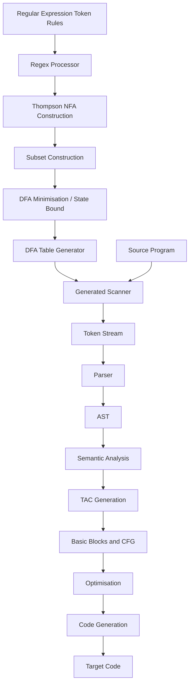
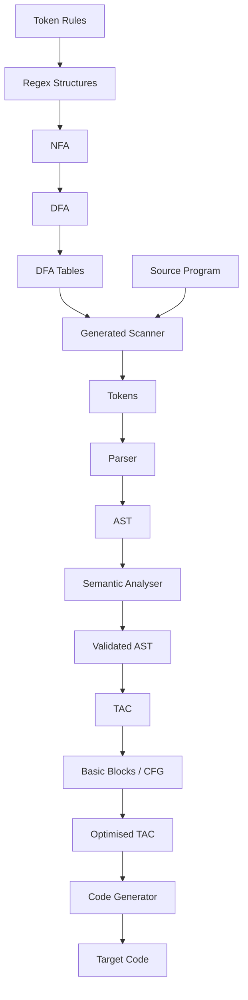

# REGEXTOOL – System Architecture and Module Interfaces

**Course:** CENP4111 – Introduction to Compiler Construction  
**Topic:** 15 – Mini-Flex Scanner Generator and Its Compiler  
**Lead Module:** 2.2 – Regular Expressions and Automata  
**Implementation Language:** C  
**Document:** D1-01  
**Version:** 1.0 – Proposed

## 1. Project Overview

REGEXTOOL is a C-based scanner generator integrated with a mini-compiler. It accepts token definitions written as regular expressions, converts them into a Deterministic Finite Automaton (DFA), and generates scanner tables that are used to recognise tokens in source programs.

Unlike a conventional compiler that uses an already-written scanner, REGEXTOOL generates its own scanner from the supplied token rules.

The project has two main operations:

**1. Scanner Generation:** Regular expressions are converted into an NFA using Thompson's Construction, then into a DFA using Subset Construction. A DFA table generator produces the scanner tables.

**2. Compilation:** The generated scanner recognises tokens in a source program. These tokens are passed through the remaining compiler stages until target code is produced.

The system will be implemented in C, with the core automata algorithms and DFA table generator developed from scratch.

## 2. Overall System Architecture

REGEXTOOL consists of two connected subsystems.

### A. Scanner Generator

| Component | Responsibility |
|---|---|
| Regex Processor | Reads and validates regular-expression token rules. |
| NFA Generator | Converts regular expressions into NFA using Thompson's Construction. |
| DFA Generator | Converts NFA into DFA using Subset Construction. |
| DFA Table Generator | Generates transition tables and accepting-state information. |

### B. Mini-Compiler

| Component | Responsibility |
|---|---|
| Generated Scanner | Uses the generated DFA tables to recognise lexemes and produce tokens. |
| Parser | Checks grammar rules and constructs an Abstract Syntax Tree (AST). |
| Semantic Analyser | Performs declaration checking, symbol-table management and type checking. |
| Intermediate Code Generator | Converts the AST into Three-Address Code (TAC). |
| Optimiser | Divides intermediate code into basic blocks, builds a Control Flow Graph and performs optimisations. |
| Code Generator | Translates optimised intermediate code into the selected target format. |
| Main Driver | Coordinates the scanner generator and all compiler stages. |

## 3. Complete Processing Pipeline

REGEXTOOL follows the following processing sequence.

### Phase A: Scanner Generation

1. Read the token-rule definitions.
2. Parse and validate the regular expressions.
3. Convert the expressions into NFA using Thompson's Construction.
4. Combine the token NFAs into a common NFA while preserving token identities and rule priorities.
5. Convert the combined NFA into DFA using Subset Construction.
6. Generate the DFA transition table and accepting-state information.
7. Apply the agreed DFA minimisation or state-bounding strategy.
8. Produce the scanner tables required by the scanner module.

### Phase B: Compilation

1. Read the source program.
2. Use the generated DFA scanner to recognise lexemes and produce tokens.
3. Pass tokens to the parser.
4. Perform syntax analysis and construct the AST.
5. Perform semantic analysis using the symbol table.
6. Generate Three-Address Code.
7. Divide the intermediate code into basic blocks and construct a Control Flow Graph.
8. Perform at least two meaning-preserving optimisations.
9. Generate target code.
10. Produce the final compilation output.

Each stage must report errors appropriately. Processing should stop when a fatal error prevents the next stage from operating correctly.

## 4. Regular Expression to NFA to DFA

This is the central algorithmic component of Topic 15.

### 4.1 Regular Expression to NFA

Thompson's Construction will be implemented from scratch to convert supported regular expressions into NFAs.

The construction uses smaller automata that are combined through:

- Concatenation.
- Alternation (`|`).
- Kleene closure (`*`).

The resulting NFA contains a start state, accepting states and transitions. Epsilon transitions may be used to move between states without consuming an input character.

### 4.2 NFA to DFA

Subset Construction will be implemented from scratch to convert the NFA into a DFA.

The algorithm:

1. Calculates the epsilon closure of the NFA start state.
2. Uses the resulting set as the initial DFA state.
3. Calculates reachable states for each input symbol.
4. Creates new DFA states for previously unseen sets.
5. Repeats until no new states are generated.
6. Identifies accepting DFA states and their corresponding token types.

### 4.3 DFA Table Generation

The resulting DFA will be represented using a transition table.

Each entry indicates the next state for a given current state and input character class.

The scanner uses this table to recognise tokens without needing to understand the internal NFA construction process.

### 4.4 DFA State Explosion

Subset Construction can produce a large number of DFA states as the number of NFA states increases.

This is an important imposed challenge for Topic 15.

The implementation must therefore use DFA minimisation where feasible or establish a reasonable state limit with proper handling when the limit is reached.

The selected strategy must be documented and demonstrated during testing.

### 4.5 Scanner Recognition Rules

The generated scanner must support:

- **Longest match:** Select the token that consumes the greatest number of input characters.
- **Keyword priority:** Give keywords priority over identifiers when both match the same longest lexeme.
- **Lexical error detection:** Report unrecognised characters and invalid lexemes with their source positions.

## 5. Scanner and Parser Communication

The generated scanner and parser will communicate through a shared token structure.

A preliminary C representation is:

```c
typedef struct {
    TokenType type;
    char *lexeme;
    int line;
    int column;
} Token;
```

The scanner exposes an interface similar to:

```c
void scanner_init(const char *source);
Token scanner_next_token(void);
void scanner_destroy(void);
```

The parser obtains tokens through `scanner_next_token()` and uses them to check the grammar and construct the AST.

The parser does not need direct access to the internal NFA or DFA structures.

## 6. Compiler Module Interfaces and Data Flow

Each module receives the output of the preceding module and performs a specific operation.

| Module | Input | Output |
|---|---|---|
| Regex Processor | Token-rule definitions | Parsed regex structures |
| NFA Generator | Parsed regular expressions | NFA states and transitions |
| DFA Generator | NFA | DFA states and transitions |
| DFA Table Generator | DFA | Scanner transition tables |
| Scanner | Source characters and DFA tables | Token stream |
| Parser | Tokens and grammar | AST |
| Semantic Analyser | AST | Validated AST and symbol-table information |
| IR Generator | Validated AST | TAC instructions |
| Optimiser | TAC | Basic blocks, CFG and optimised TAC |
| Code Generator | Optimised TAC | Target code |

### Communication between compiler stages

The parser passes the AST to the semantic analyser. The semantic analyser checks declarations and types before the intermediate code generator processes the validated tree.

The intermediate code generator produces TAC, which is divided into basic blocks for control-flow analysis and optimisation.

The code generator then translates the optimised TAC into the selected target format.

All modules must use agreed interfaces and shared data structures rather than accessing one another's internal implementation directly.

## 7. Grammar and Syntax Analysis Requirements

The mini-language must have a documented grammar.

The parser development must demonstrate:

- Grammar production rules.
- At least one derivation and its corresponding parse tree.
- Identification and resolution of ambiguity.
- Removal of left recursion where necessary.
- Left factoring where necessary.
- FIRST and FOLLOW sets.
- Shift-reduce operations and handle pruning.
- An LR(0) or SLR parsing table for an appropriate grammar fragment.

The team will select a suitable parsing implementation and document the corresponding design. The generated scanner must supply the tokens used by that parser.

## 8. Semantic Analysis and Intermediate Representation

### Semantic Analysis

The semantic analyser will maintain a symbol table containing information about declared identifiers.

It must demonstrate:

- Declaration-before-use checking.
- Duplicate declaration checking where applicable.
- Type checking.
- Detection of invalid assignments and operations.

### Intermediate Code Generation

The compiler will use Three-Address Code (TAC) as its intermediate representation.

For example:

```text
result = a + b;
```

May produce:

```text
t1 = a + b
result = t1
```

TAC must also demonstrate the translation of control-flow constructs such as `if` and `while`.

## 9. Optimisation and Code Generation

### Optimisation

The optimiser will:

1. Identify basic blocks.
2. Construct a Control Flow Graph.
3. Perform at least two meaning-preserving local optimisations.

Possible techniques include constant folding, constant propagation, dead-code elimination and algebraic simplification.

At least two optimisations must be demonstrated with before-and-after examples and explanations of why the program's meaning is preserved.

### Code Generation

The code generator will translate optimised TAC into the agreed target format.

The implementation must demonstrate:

- Target instruction generation.
- Sethi–Ullman labelling for expression evaluation.
- Register allocation or the appropriate storage-management strategy.
- Activation-record considerations where required by the selected language and target.

The target instruction set and execution method must be agreed upon before implementation.

## 10. System Architecture Diagram



## 11. Compiler Data-Flow Diagram



## 12. Compiler Construction T-Diagram

The T-diagram describes the compiler being constructed and the language used to implement it.

```text
             SOURCE LANGUAGE
            (REGEXTOOL mini-language)
                    |
                    |
        -------------------------
        |                       |
        |     REGEXTOOL         |
        |                       |
        -------------------------
                    |
                    |
             TARGET LANGUAGE
          (Agreed target format)

       Implementation language: C
       Host environment: Linux / GCC
```

REGEXTOOL is implemented in C and translates programs written in its defined mini-language into the agreed target format.

The scanner generator is a separate construction stage that produces the lexical analyser used by this compiler.

## 13. Project Folder Structure

The project will use a simple modular structure:

```text
REGEXTOOL/
│
├── src/
│   ├── regex.c
│   ├── nfa.c
│   ├── dfa.c
│   ├── scanner.c
│   ├── parser.c
│   ├── semantic.c
│   ├── ir.c
│   ├── optimiser.c
│   ├── codegen.c
│   └── main.c
│
├── include/
│   ├── regex.h
│   ├── automata.h
│   ├── scanner.h
│   ├── parser.h
│   ├── semantic.h
│   ├── ir.h
│   ├── optimiser.h
│   └── codegen.h
│
├── tests/
├── examples/
├── docs/
│   └── architecture.md
│
├── report/
├── Makefile
├── README.md
└── .gitignore
```

**Folder responsibilities:**

- `src/`: Contains the implementation of the project modules.
- `include/`: Contains shared header files and interfaces.
- `tests/`: Contains valid and invalid test cases for individual modules and the integrated compiler.
- `examples/`: Contains sample token rules and source programs.
- `docs/`: Contains technical documentation.
- `report/`: Contains the academic project report.

The Makefile handles compilation and building, while the README explains the language, grammar, setup, building and execution.

## 14. Module Dependencies and Integration

The main dependency sequence is:

```text
Regex Processor
      ↓
NFA Generator
      ↓
DFA Generator
      ↓
DFA Table Generator
      ↓
Generated Scanner
      ↓
Parser
      ↓
Semantic Analyser
      ↓
Intermediate Code Generator
      ↓
Optimiser
      ↓
Code Generator
```

The main driver coordinates the complete process.

Each module must expose agreed function interfaces and shared data structures through header files. Modules should be tested independently before integration.

The integration stage must ensure that the generated scanner actually drives the mini-compiler and that errors from different compilation stages are reported consistently.

## 15. Testing and Correctness

The project must include tests for both valid and invalid inputs.

Testing should cover:

- Regular-expression parsing and validation.
- Correct Thompson NFA construction.
- Correct subset construction and DFA transitions.
- DFA state growth and the selected state-management strategy.
- Longest-match recognition and keyword priority.
- Token delivery to the parser.
- Grammar and syntax checking.
- Semantic errors and symbol-table operations.
- TAC generation and optimisation.
- Target code generation.
- Complete end-to-end compilation.

The correctness argument should explain how each stage preserves the intended meaning of the program.

In particular, the NFA and DFA must recognise the same language as the original regular expressions. The generated scanner must produce the expected tokens, and subsequent compiler stages must preserve the program's meaning through translation and optimisation.

## 16. Decisions Requiring Team Agreement

Before implementation, the team must agree on:

1. Supported regular-expression operators and syntax.
2. Token-rule input-file format.
3. The mini-language grammar and supported constructs.
4. Shared C data structures and function interfaces.
5. DFA minimisation or state-bounding strategy.
6. Target code format and execution method.

These decisions must be documented to ensure that independently developed modules remain compatible.

## 17. Conclusion

REGEXTOOL is a scanner generator and mini-compiler whose main contribution is the construction of a DFA scanner from regular-expression token rules.

Through Thompson's Construction, Subset Construction and DFA table generation, the system will produce a working scanner that drives the lexical-analysis stage of the mini-compiler.

The remaining compiler stages will demonstrate the complete compiler-construction process, including grammar analysis, parsing, semantic analysis, intermediate-code generation, optimisation and code generation.

This architecture establishes the module responsibilities, processing pipeline, interfaces, dependencies and project organisation required for implementation and integration.